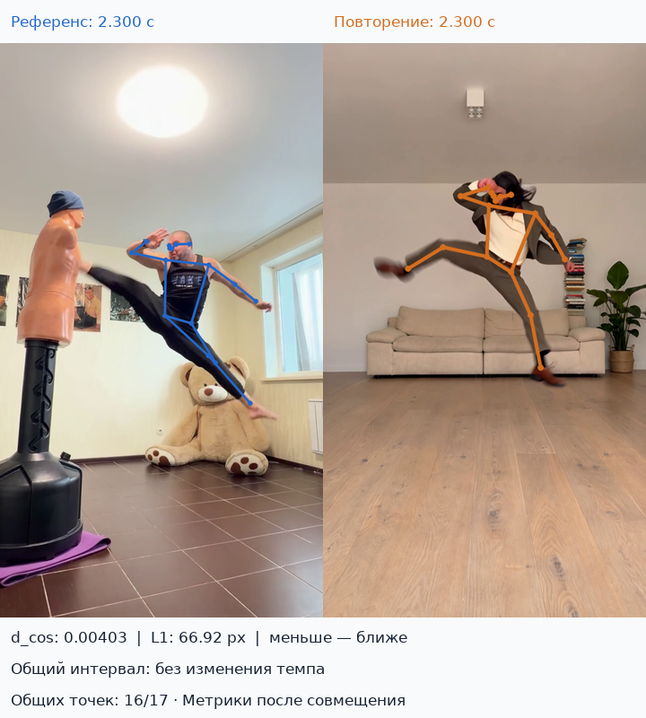
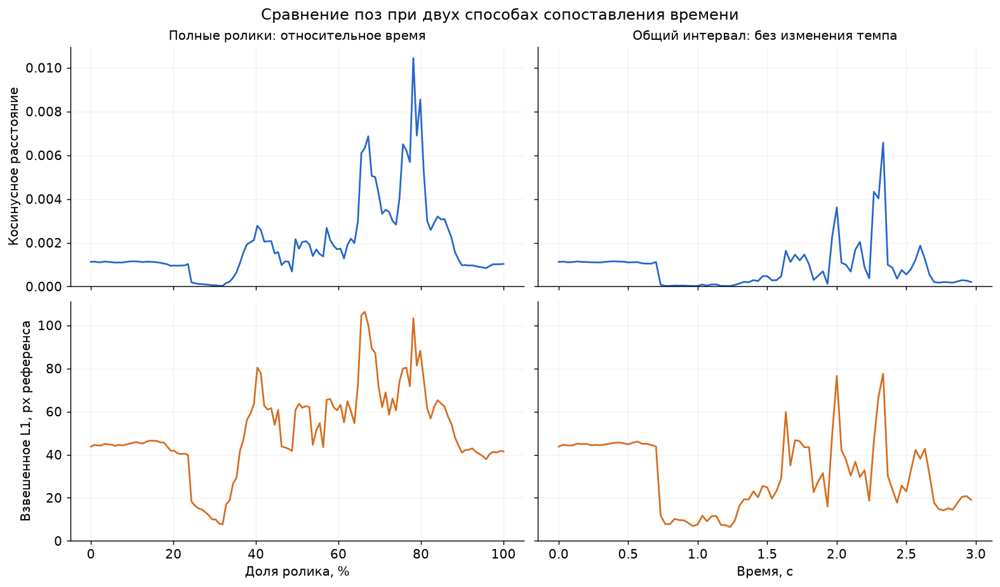

# Easy Motion — виртуальный коуч

**Автор: Олег Константиныч**

Дипломный проект Skillfactory, специализация Data Science / Computer Vision.

Репозиторий: [Enfox/sf_data_science, папка PROJECT_EASY-MOTION](https://github.com/Enfox/sf_data_science/tree/main/PROJECT_EASY-MOTION).

Программа сравнивает повторение движения с референсным видео. Готовая нейросеть
находит ключевые точки человека, затем программа совмещает позы и рассчитывает
косинусное и взвешенное расстояния. На выходе получается видео со скелетами и метриками.

В качестве примера выбрано повторение удара ногой в единоборствах.



[Видео полных роликов](results/relative/comparison.mp4) ·
[Видео без изменения темпа](results/realtime/comparison.mp4) ·
[Учебный ноутбук](examples/01_video_comparison.ipynb) ·
[Презентация](presentation/Easy_Motion.pptx)

## Цель и задачи

Цель — сделать понятный прототип для визуального сравнения движений.

1. Загрузить референс и запись повторения.
2. Найти 17 ключевых точек спортсмена на кадрах.
3. Сопоставить кадры двух роликов и привести позы к одной системе координат.
4. Рассчитать расстояния и показать, где позы различаются.
5. Сохранить видео, график и таблицы результатов.

Программа оценивает сходство двумерных поз. Она не определяет правильность
спортивной техники, силу удара или причину различий.

## Данные

| Файл | Содержание | Размер кадра | FPS | Кадров | Длительность |
| --- | --- | --- | ---: | ---: | ---: |
| `data/reference_video.mp4` | Референс удара ногой | 720 × 1280 | 60 | 180 | 3 с |
| `data/my.mp4` | Моё повторение движения | 480 × 854 | 30 | 120 | 4 с |

Используются два коротких предоставленных видео. Отдельной обучающей выборки
и ручной разметки суставов в проекте нет. Нейросеть уже обучена на COCO;
в проекте выполняется только получение предсказаний. Форматы и происхождение
данных описаны в [data/README.md](data/README.md).

## Как работает сравнение

```text
MP4 → RGB-кадры → Keypoint R-CNN → выбор спортсмена
    → сопоставление времени → аффинное совмещение поз
    → расстояния → видео, CSV, JSON и график
```

Модель — **Keypoint R-CNN ResNet-50 FPN**, веса **COCO_V1** из torchvision.
Порог score человека — `0.9`, score ключевой точки — `2.0`, минимум общих точек — `6`.
Score точки используется как вес, но не считается вероятностью.

На референсе слева есть манекен. Программа выбирает человека с центром рамки
правее 40% ширины кадра. Эта граница относится именно к демонстрационным данным;
при работе с другим референсом её нужно изменить в `scripts/pipeline.py`.
Изображение не обрезается.

Ролики имеют разную длительность, поэтому рассчитаны два режима:

- **relative:** целые ролики, сопоставление одинаковой доли времени; 120 пар.
- **realtime:** одинаковые секунды от начала, только общие первые 3 с; 90 пар.

В первом режиме референс воспроизводится медленнее. Во втором последняя секунда
повторения не участвует. Паузы в начале или конце могут влиять на результат.
Автоматического поиска сдвига и нелинейного растяжения времени здесь нет.

**Косинусное расстояние** — `1 − cosine_similarity`, диапазон `[0, 2]`.
**Взвешенное L1** — среднее `|dx| + |dy|` по общим суставам с весами из `my.mp4`.
Его единица — пиксель исходного референса. Для обеих метрик меньше означает ближе.
Формулы, допущения и ограничения — в [docs/METHOD.md](docs/METHOD.md).

## Результат

Значения получены на включённых в репозиторий видео после аффинного совмещения:

| Режим | Пригодных пар | Среднее косинусное расстояние | Среднее L1, px |
| --- | ---: | ---: | ---: |
| Полные ролики, relative | 120 / 120 | 0.001987 | 51.357 |
| Общие первые 3 с, realtime | 90 / 90 | 0.000861 | 30.437 |



В контрольном режиме расстояния меньше. Однако режимы сравнивают разные временные
сопоставления и разный охват, поэтому эта разница не является доказательством
улучшения модели. Высокое косинусное сходство нельзя переводить в процент качества удара.

Полная аффинная подгонка допускает отражение: оно встречается в 75 из 120 пар
основного режима. Это существенное ограничение такого способа сравнения.
Подробности экспериментов и валидации: [docs/EXPERIMENTS.md](docs/EXPERIMENTS.md).

## Структура проекта

```text
PROJECT_EASY-MOTION/
├── README.md
├── requirements.txt
├── pyproject.toml
├── .gitignore
├── .gitattributes
├── data/                         # два исходных видео и описание
├── examples/
│   └── 01_video_comparison.ipynb  # выполненный пример
├── images/                       # иллюстрации для README
├── src/
│   ├── easy_motion/              # независимые расчёты и метрики
│   ├── easy_motion_data/         # VideoDataset и сопоставление кадров
│   ├── easy_motion_models/       # готовая нейросеть
│   └── easy_motion_visualization/# скелеты, график, сохранение MP4
├── scripts/
│   ├── main.py                   # основной запуск
│   └── pipeline.py               # связывает четыре пакета в общий сценарий
├── tests/                        # проверки математики
├── results/
│   ├── relative/                 # comparison.mp4 и frame_metrics.csv
│   ├── realtime/                 # comparison.mp4 и frame_metrics.csv
│   ├── summary.json
│   ├── demo.png
│   └── metrics.png
├── docs/                         # метод, эксперименты, соответствие заданию
└── presentation/
    └── Easy_Motion.pptx           # презентация по шаблону Skillfactory
```

Четыре небольших пакета разделяют расчёты, данные, модель и визуализацию.
Они не импортируют друг друга. Общая последовательность обработки находится
в `scripts/pipeline.py`; её вызывают основной скрипт и учебный ноутбук.
Веб-сервера, базы данных и сложной системы конфигурации нет.

## Установка и запуск

Проверено на **Python 3.11** и Windows. Нужен **FFmpeg** с поддержкой H.264 в `PATH`.
Ссылки на готовые сборки есть на [странице FFmpeg](https://ffmpeg.org/download.html).
После установки откройте новый терминал и проверьте `ffmpeg -version`.

Выполняйте команды из корня `PROJECT_EASY-MOTION`.

**Windows / PowerShell:**

```powershell
py -3.11 -m venv .venv
.\.venv\Scripts\python.exe -m pip install --upgrade pip
.\.venv\Scripts\python.exe -m pip install -r requirements.txt
.\.venv\Scripts\python.exe scripts/main.py
```

**Linux / macOS:**

```bash
python3.11 -m venv .venv
.venv/bin/python -m pip install --upgrade pip
.venv/bin/python -m pip install -r requirements.txt
.venv/bin/python scripts/main.py
```

Для Linux/macOS сами исходники совместимы, но эти системы в текущей работе не проверялись.
При первом запуске torchvision скачивает веса модели. Веса не хранятся в Git.
GPU не обязателен: программа автоматически выбирает CUDA, если она доступна,
иначе CPU. Обработка на CPU занимает больше времени. Короткие ролики хранятся в памяти;
для длинных записей этот учебный вариант нужно переделать на потоковую обработку.

Другие пути можно передать явно:

```powershell
.\.venv\Scripts\python.exe scripts/main.py --reference data/reference_video.mp4 --input data/my.mp4 --output results_new
```

Повторный запуск перезаписывает файлы выбранной папки результатов. Исходные видео не меняются.
Картинки в `images/` — иллюстрации проверенного запуска для страницы GitHub.
Новые расчёты сохраняются в выбранную папку результатов; при замене данных обновите
иллюстрации и численные выводы в документации.

## Ноутбук и проверки

Откройте `examples/01_video_comparison.ipynb` в VS Code с расширением Jupyter
и выберите `.venv/Scripts/python.exe`. Выполните **Restart Kernel → Run All**.
Пример обращается к тем же модулям, что и основной скрипт.
В первой ячейке путь к `scripts/` добавляется в путь поиска Python,
чтобы импортировать общий сценарий `pipeline.py`.

```powershell
.\.venv\Scripts\python.exe -m unittest discover -s tests -v
```

Проверяются известные значения метрик, аффинное преобразование, вырожденные точки
и пропуски. Это проверка кода, а не качества модели на независимой выборке.

## Этапы работы

1. Спринт I: извлечение ключевых точек и отрисовка скелета на фото.
2. Спринт II: сравнение двух поз, аффинное совмещение и метрики.
3. Спринт III: сравнение последовательностей кадров на видео с танцевальным движением.
4. Спринт IV: применение к повторению удара ногой, анализ двух временных режимов.
5. Спринт V: разделение кода на модули, документация, пример запуска и презентация.

Финальный репозиторий содержит один законченный пример из спринта IV.
Ранние учебные ноутбуки не требуются для его запуска.

## Соответствие заданию

- [Сопоставление с требованиями задания](docs/ASSIGNMENT.md)

Использованные источники: [модель torchvision](https://docs.pytorch.org/vision/0.20/models/generated/torchvision.models.detection.keypointrcnn_resnet50_fpn.html),
[OpenCV VideoCapture](https://docs.opencv.org/4.x/d8/dfe/classcv_1_1VideoCapture.html).
